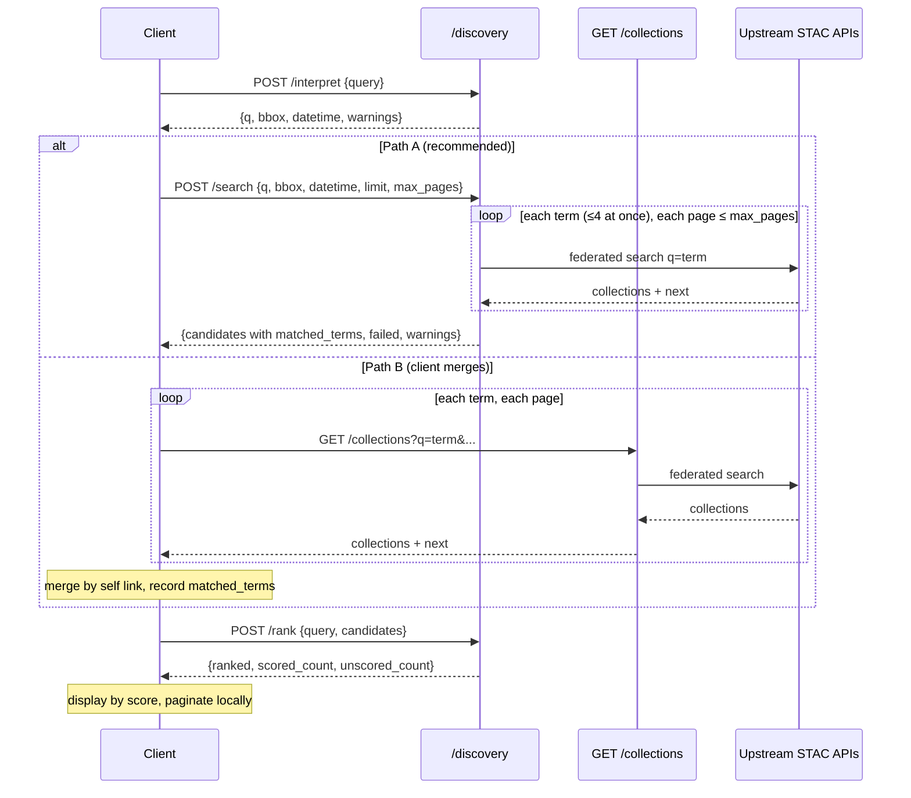

# Spec: LLM-Assisted Search via `/discovery` Endpoints

## Context

PR feedback on `feat/e2e-llm-assist` observed that the prototype bakes
pagination, candidate limits, and orchestration into a single server-side
pipeline, reachable through a `query` parameter on `GET /collections`. That gives
clients no control over the process, adds a second execution mode to a STAC
endpoint, and does not fit an application whose clients (e.g. the
stac-collection-discovery app) already own the search UX.

This spec replaces that design with a small family of composable endpoints under
`/discovery`. The LLM-backed steps that already exist (`llm/*`) are kept; the
server-side orchestration around them is removed. The client performs the search.

Amendment (review of this PR): with only `interpret` and `rank`, the per-term
fan-out, merge and `matched_terms` tracking existed only in the reference
client (`streamlit_app.py`), so every client had to re-implement the step that
feeds the pre-sort. An optional, non-LLM `POST /discovery/search` now performs
that step server-side. The split is kept: `interpret`, `search` and `rank` are
independent calls, and a client may still search `GET /collections` itself.

## Goals

- **Primary:** Expose LLM query interpretation and LLM ranking as two
  independent, stateless endpoints a client can compose.
- **Secondary:** Return `GET /collections` to its pre-prototype behaviour; it
  has no LLM mode.
- **Tertiary:** Preserve the term-coverage pre-sort from commit `6d3cc4a`, now
  fed by `matched_terms` computed by `/discovery/search` or reported by the
  client.
- **Quaternary:** One server-side implementation of the per-term fan-out,
  merge and `matched_terms` tracking (`POST /discovery/search`), so clients do
  not have to write it.
- **Non-goal:** An all-in-one search endpoint (interpret, search and rank in
  one call). If round-trip latency proves too high, a separate `/discover`
  endpoint may be added later; it is not part of this work.
- **Non-goal:** Cross-upstream deduplication of the same collection served
  under different URLs (e.g. CMR `ALL` and `LPCLOUD`); identity is the `self`
  link.
- **Non-goal:** Rate limiting or authentication for the new endpoints.
- **Non-goal:** Server-side pagination of ranked results (the client
  paginates its own ordered list).

## Client flow



1. User submits a natural-language query.
2. `POST /discovery/interpret` -> `{q: [...], bbox, datetime}`.
3. Either (recommended) `POST /discovery/search` with `q`, `bbox` and
   `datetime`, which returns rank-ready candidates with server-computed
   `matched_terms` (see below), or the client does the equivalent itself:
   for each term in `q`, `GET /collections?q=<term>&bbox=..&datetime=..&limit=<page>`
   (overfetch), following `next` tokens up to a client-chosen total. The client
   merges results by collection identity and records, per collection, every
   term that returned it (`matched_terms`).
   - `limit` is passed verbatim to **each** upstream (this app caps it at
     10,000 but does not clamp to upstream maximums), and an upstream that
     rejects it is reported as a failed API. Clients should use a moderate
     page size (e.g. 100) and page via tokens rather than one huge `limit`.
   - Source identity comes from the collection's own `rel: "self"` link, which
     upstream APIs already include (verified against recorded eoapi responses:
     `self` points at the upstream's `/collections/{id}`). Clients use
     `self` (falling back to `id`) to build a source-qualified `ref`.
4. `POST /discovery/rank` with the original query and the merged candidates.
5. The client displays candidates ordered by score and paginates locally.

One request per term (rather than a comma-joined `q`) is deliberate: upstream
APIs interpret multi-term `q` differently, and the per-term hits are the signal
used for pre-sorting. `/discovery/search` keeps this rule; it moves the work to
the server, it does not change it.

## Endpoints

All three are registered on a `/discovery` router **only when `llm_provider` and
`llm_api_key` are set**; otherwise the routes do not exist (404). A conformance
class and landing-page links advertise them so clients can detect the feature.

### `POST /discovery/interpret`

Request:

```json
{ "query": "wildfires in California 2023", "max_terms": 5 }
```

- `max_terms` is optional (integer, at least 1; default 10). It is the client's
  cap on the number of terms in `q` (topic plus expansions). A value above the
  operator ceiling `discovery_max_terms` (default 25) returns `422` stating the
  ceiling; it is never silently clamped.

Response `200`:

```json
{
  "q": ["wildfire", "burned area", "fire"],
  "bbox": [-124.48, 32.53, -114.13, 42.01],
  "datetime": "2023-01-01T00:00:00Z/2023-12-31T23:59:59Z",
  "warnings": []
}
```

- `q` is always an array (first element is the topic; the rest are LLM
  expansions; at most `max_terms` entries in total). Empty if the query has no
  topic.
- `bbox` and `datetime` are `null` when absent from the query or not resolvable.
- A failed sub-step (date parse, geocode, expansion) yields `null`/fewer terms
  and a human-readable entry in `warnings`; the response is still `200`.
- LLM unreachable, rate limited, or misconfigured: `503`. Empty `query`: `422`.
- No upstream searching occurs, and no explicit-override logic: the client
  decides whether to use or replace the suggestions.

Built from the existing `QueryDecomposer`, `DateParser`, `Geocoder` and
`QueryExpander`.

Geocoding: the prototype defaults to the public `nominatim.openstreetmap.org`,
whose usage policy (about 1 request/second, identifying User-Agent) does not
allow serving an open endpoint. `geocoding_service_url` is therefore required
for location resolution; when unset, `bbox` is `null` with a warning and no
request is made. Geocoder requests send an identifying User-Agent, and results
are cached in-process by normalized place name.

### `POST /discovery/rank`

Request:

```json
{
  "query": "wildfires in California 2023",
  "max_scored": 50,
  "candidates": [
    {
      "ref": "https://api.example/collections/landsat-c2",
      "id": "landsat-c2",
      "title": "Landsat Collection 2",
      "matched_terms": ["wildfire", "fire"]
    }
  ]
}
```

- `max_scored` is optional (integer, at least 1; default 50): how many
  candidates, chosen by term coverage, the LLM scores. A value above the
  operator ceiling `discovery_max_scored` (default 100) returns `422` stating
  the ceiling; it is never silently clamped. A value larger than the number of
  candidates scores them all.

- Candidates are **slim**: only `id` (required), `title`, and `matched_terms`.
  Full collection objects are not accepted; they can be megabytes and the
  server uses only `id` and `title` (which also limits prompt-injection
  surface from upstream text). Unknown fields are rejected (422).
- `ref` is an opaque client-chosen string, echoed back. Optional; defaults to
  `id`. Clients merging across upstreams should supply source-qualified refs
  (e.g. the collection's `self` href), since ids can collide.
- `matched_terms` is optional; when absent, the pre-sort is a no-op.

Response `200`, ordered best first:

```json
{
  "ranked": [
    { "ref": "https://api.example/|landsat-c2", "score": 8.5, "reason": "..." }
  ],
  "scored_count": 1,
  "unscored_count": 0,
  "warnings": []
}
```

`scored_count` is how many candidates the LLM scored; `scored_count +
unscored_count` equals the number of candidates sent.

Behaviour:

1. Stable-sort candidates by `len(matched_terms)` descending (term coverage).
2. Score the first `max_scored` with the existing single batched
   `CollectionReranker` call.
3. Candidates beyond the cap are appended after the scored ones with
   `score: null` and reason `"not scored: over candidate cap"`, so none are
   lost. `unscored_count` reports how many. (This relaxes the prototype rule
   that every returned candidate is scored; it is now scoped to candidates
   within the cap.)
4. Every scored candidate has a score and a reason. If the LLM call fails, all
   candidates are returned unscored in pre-sort order with a warning, status
   `200`, matching the prototype's fallback.
5. No `top_k`: all candidates are returned.

Limits. The client chooses how much work to ask for; the server only enforces
operator-set **ceilings** (settings), each rejecting with `422` and naming the
ceiling:
- Scored window: the request's `max_scored` (default 50), at most
  `discovery_max_scored` (default 100).
- Terms: the `interpret` request's `max_terms` (default 10), at most
  `discovery_max_terms` (default 25).
- Request size: at most `discovery_max_candidates` candidates per `rank`
  request (default 200); `search` returns at most this many. Because candidates are slim, 200 is on the order of
  tens of KB.
- All three settings have `ge=1`. The defaults 10 and 50 are constants in
  `discovery.py`, not settings.
- This is a **top-N ranking**: the LLM scores the N best candidates by term
  coverage; the remainder are ordered by coverage only. A client that needs a
  score for every candidate should send at most `max_scored` candidates.
  The request size limit exists so the pre-sort has something to choose from.
  Scores from separate `rank` calls are not comparable with one another.
- The LLM's `max_tokens` must scale with the scored window (the prototype's
  fixed 1024 is too small for 50 scored items with reasons).
- Duplicate `ref`s return `422`. Empty `candidates` returns `200` with an empty
  `ranked` list. LLM misconfiguration: `503`.
- `reason` strings are LLM-generated plain text; clients must escape them
  before rendering as HTML.

### `POST /discovery/search`

The server-side version of client flow step 3. It makes no LLM call; it is
registered with the other discovery endpoints so the family is detected
together.

Request (field names match the `interpret` response, so a client copies `q`,
`bbox` and `datetime` across):

```json
{
  "q": ["wildfire", "burned area", "fire"],
  "bbox": [-124.48, 32.53, -114.13, 42.01],
  "datetime": "2023-01-01T00:00:00Z/2023-12-31T23:59:59Z",
  "limit": 100,
  "max_pages": 2,
  "apis": ["https://api.example/"],
  "include_collections": false
}
```

- `q`: list of terms, at most `discovery_max_terms`. Empty or omitted means one
  search without `q` (bbox/datetime only); blank terms are rejected and
  repeated terms are searched once.
- `bbox`, `datetime`, `apis`: passed to `GET /collections` unchanged; `apis`
  defaults to the configured upstreams.
- `limit`: per-upstream page size (default 100, 1 to 1000).
- `max_pages`: pages followed per term via `next` (default 2), at most the
  operator ceiling `discovery_max_pages` (default 5), `422` above it.
- `include_collections`: when true, the full collection objects are returned
  alongside the candidates (for display). Default false, because they can be
  megabytes.
- Unknown fields are rejected (`422`).

Behaviour:

1. One federated search per term through the same code as `GET /collections`
   (called in-process, so the multi-word `q` retry and failure handling
   apply). Terms run concurrently, at most 4 at a time; each term follows
   `next` up to `max_pages`.
2. Results are merged by `ref`: the collection's `self` link, else its `id`.
   Each candidate's `matched_terms` lists, in `q` order, the terms that
   returned it (empty for the no-`q` search).
3. Candidates are stable-sorted by `len(matched_terms)` descending (first-seen
   order breaks ties) and truncated to `discovery_max_candidates`, so the
   response can be sent to `rank` as is. Truncation adds a warning.
4. An upstream that fails for a term is reported in `failed` as
   `{"api", "term"}`; the other terms and upstreams still return. The response
   is `200` even if everything failed.

Response `200`:

```json
{
  "candidates": [
    {
      "ref": "https://api.example/collections/landsat-c2",
      "id": "landsat-c2",
      "title": "Landsat Collection 2",
      "matched_terms": ["wildfire", "fire"]
    }
  ],
  "found_count": 1,
  "failed": [{ "api": "https://other.example/", "term": "burned area" }],
  "collections": null,
  "warnings": []
}
```

- `candidates` have exactly the `rank` candidate fields.
- `found_count` is the number of unique collections before truncation.
- `collections` maps `ref` to the full collection object when
  `include_collections` is true, else `null`.

## Changes to existing code

**Add**
- `discovery.py` (router, request/response models, handlers; `search` calls
  the app's `CollectionSearchClient.all_collections`), registered from
  `StacCollectionSearchApi` using the `APIRouter` pattern already used for the
  `/_mgmt` endpoints.
- Conformance class and landing-page links for the discovery endpoints.
- Operator ceiling settings `discovery_max_terms`, `discovery_max_scored`,
  `discovery_max_candidates` (these replace `max_expansion_terms`,
  `rerank_candidate_count` and `rerank_max_request_candidates`), plus `discovery_max_pages` for `search`.
- No change to `GET /collections` is needed for source identity: upstream
  collections already carry a `self` link (see Client flow).

**Modify**
- `llm/reranker.py`: accept `matched_terms` per candidate, perform the
  term-coverage pre-sort and over-cap handling, and drop `top_k`. Replace the
  `_source_api` / `_matched_terms` keys injected into collection dicts with
  explicit input fields.

**Remove**
- `query` param and `_assisted_collections` in `core.py` and `app.py`, plus the
  `metadata` field added to `CollectionSearchResult` and the `assisted_search`
  response fields.
- `pipeline.py` and `search.py` (server-side fan-out).
- Settings that nothing reads: `query_expansion_enabled`, `reranking_enabled`,
  `date_parsing_enabled`, `location_parsing_enabled`, and `rerank_return_count`.
  Steps are gated only on the LLM being configured.
- Root-level `test_*.py` scripts; `streamlit_app.py` is rewritten as a
  reference client following the flow above, calling `/discovery/search`
  rather than merging results itself.

## Testing

- Unit tests (`tests/unit/`) with a stubbed `LLMClient`:
  - `interpret`: full decomposition; absent location/date -> nulls; geocode or
    date failure -> warnings and `200`; LLM error -> `503`; empty `query` -> `422`.
  - `rank`: ordering by score; pre-sort by term coverage with stable ties; cap
    handling and `unscored_count`; ref echo and default to `id`; duplicate
    refs -> `422`; oversize request -> `422`; LLM failure fallback; empty list.
  - Routes absent (404) when LLM is not configured.
  - `GET /collections` has no `query` param and unchanged behaviour.
  - Geocoding disabled (no `geocoding_service_url`) -> `bbox: null` + warning.
  - `rank` rejects full collection objects and unknown fields (422).
  - `search` (upstreams mocked with `respx`): merge by `self` link with
    `matched_terms` in `q` order; fallback to `id`; coverage sort and
    truncation warning; paging up to `max_pages`; per-(api, term) failures;
    no-`q` search; `include_collections`; `max_pages`/`q` ceilings (422);
    output accepted by `rank` unchanged.
- Reranker unit tests replace the old pipeline/rerank script coverage.
- The existing live-API integration test is untouched.

## Risks and open items

- Latency: three sequential hops plus N per-term `/collections` calls. Term
  requests run in parallel client-side; revisit a `/discover` all-in-one
  endpoint if measured latency is unacceptable.
- Client complexity: addressed by `/discovery/search`. Clients that search
  `/collections` directly still own the merge.
- Both endpoints spend LLM tokens without authentication. The request-size cap
  and per-call LLM timeouts bound per-call cost, but not call volume; rate
  limiting is left to deployment. `interpret` is a pure function of the query,
  so a small in-process cache keyed on the normalized query is cheap to add and
  is recommended.
- Load: each per-term search federates to every upstream, so one `search`
  call can make up to terms x pages x upstreams requests (25 x 5 x upstreams at
  the ceilings). The ceilings and the 4-term concurrency bound it; `search` is
  unauthenticated like the rest, so rate limiting is left to deployment.
- Ranking quality is judged on id and title only; adding a truncated
  description or keywords is a possible follow-up at a token cost. Stubbed-LLM
  tests prove behaviour, not relevance; a small fixed set of queries with
  expected top results would guard prompt/model changes.
- Observability: log LLM latency, token usage and failures per endpoint; decide
  whether raw query text is logged.
- Naming: `/discovery/*` is used here for the new family; `/discover` is
  reserved for a possible future all-in-one endpoint. Confirm with the reviewer.
